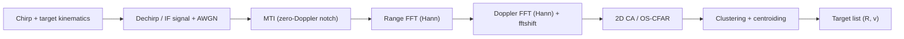

# FMCW Automotive Radar: Range-Doppler Processing & CFAR Detection

A 77 GHz Frequency-Modulated Continuous Wave (FMCW) radar signal processing pipeline implemented in MATLAB. The simulation models target reflection kinematics, generates Intermediate Frequency (IF) beat signals, maps targets in Range-Doppler space via 2D FFT, and performs adaptive threshold detection using Constant False Alarm Rate (CFAR) algorithms (1D/2D CA-CFAR and 2D OS-CFAR), followed by clutter suppression and target extraction.

**Toolboxes:** base MATLAB (R2020a+ recommended). `hann()` from the Signal Processing Toolbox is used when available, with a built-in fallback, so no toolbox is strictly required.

---

## Deliverables

| # | Deliverable | Where |
| :--- | :--- | :--- |
| 1 | LFMCW chirp sequence reflecting off 2–3 moving targets with AWGN | [`generate_fmcw_if.m`](src/generate_fmcw_if.m), [`day2_signal_generation.m`](src/day2_signal_generation.m) |
| 2 | 2D FFT: fast-time FFT → range, slow-time FFT → Doppler / radial velocity | [`range_doppler_map.m`](src/range_doppler_map.m), [`day3_range_doppler_processing.m`](src/day3_range_doppler_processing.m) |
| 3 | 2D CA-CFAR **and** OS-CFAR across the Range-Doppler map, rejecting clutter | [`ca_cfar_2d.m`](src/ca_cfar_2d.m), [`os_cfar_2d.m`](src/os_cfar_2d.m), [`day5_ca_cfar_2d.m`](src/day5_ca_cfar_2d.m), [`day6_clutter_os_cfar.m`](src/day6_clutter_os_cfar.m) |

---

## System Specifications & Waveform Design

| Parameter | Symbol | Design Value |
| :--- | :--- | :--- |
| Carrier Frequency | $f_c$ | 77 GHz |
| Wavelength | $\lambda$ | ~3.89 mm |
| Operating Bandwidth | $B$ | 150 MHz |
| Range Resolution | $\Delta R$ | 1.0 m |
| Max Unambiguous Range | $R_{\max}$ | 200 m |
| Chirp Duration | $T_c$ | 10 $\mu$s |
| Chirp Slope | $S$ | 15 MHz/$\mu$s ($1.5 \times 10^{13}$ Hz/s) |
| ADC Sample Rate | $f_s$ | 51.2 MHz |
| Max Unambiguous Velocity | $v_{\max}$ | 97.4 m/s (~350 km/h) |
| Velocity Resolution | $\Delta v$ | 1.52 m/s |
| Fast-Time Samples / Chirp | $N_r$ | 512 |
| Slow-Time Chirps / Frame | $N_d$ | 128 |

### Simulated scenario

| Target | Range | Radial velocity | Relative amplitude |
| :--- | :--- | :--- | :--- |
| T1 – approaching car | 45.3 m | −18 m/s | 1.0 |
| T2 – receding car | 110.0 m | +12 m/s | 0.6 |
| T3 – fast oncoming vehicle | 165.7 m | −35 m/s | 0.4 |

AWGN is set so that the strongest target has an SNR of −5 dB per ADC sample, which means the targets are buried in the raw IF data. The Day 6/7 scenario also adds a weak target (114 m, +13.5 m/s) right next to T2, plus 60 stationary clutter scatterers.

---

## Architecture & Mathematical Formulation



### 1. Transmit Waveform & Propagation
The radar transmits an up-chirp linear frequency modulated (LFM) continuous wave:
$$s_{tx}(t) = \cos\left(2\pi f_c t + \pi S t^2\right)$$

Target reflections arrive delayed by round-trip transit time $\tau(t) = \frac{2 R(t)}{c}$, where target motion across chirps is modeled as $R(t) = R_0 + v(d \cdot T_c + t)$.

### 2. Dechirping / Mixing
The received echo $s_{rx}(t)$ is mixed with $s_{tx}(t)$ and low-pass filtered, yielding the Intermediate Frequency (IF) beat tone:
$$s_{IF}(t, d) \approx A \cos\left( 2\pi \left[\frac{2 S R_0}{c}\right] t + 2\pi \left[\frac{2 v}{\lambda}\right] d T_c + \frac{4\pi R_0}{\lambda} \right)$$
* **Fast-Time ($t$):** Maps directly to **Range** via beat frequency $f_b = \frac{2 S R}{c}$.
* **Slow-Time ($d$):** Maps directly to **Radial Velocity** via inter-chirp Doppler phase progression $\Delta\phi = 2\pi f_d T_c$.

The simulator evaluates the exact mixer output $\cos\left(2\pi\left[f_c\tau + S\tau t - \tfrac{1}{2}S\tau^2\right]\right)$ analytically, so it never has to sample the 77 GHz carrier.

### 3. 2D Spectral Estimation (Range-Doppler Map)
* **Stage 1 (Range FFT):** Column-wise FFT applied across fast-time samples with Hann windowing to suppress range sidelobes.
* **Stage 2 (Doppler FFT):** Row-wise FFT across chirps followed by `fftshift` to resolve positive (receding) and negative (approaching) velocity vectors.

### 4. Adaptive Detection (CA-CFAR)
To maintain a Constant False Alarm Rate under varying noise floors, a dynamic threshold $T$ is calculated across sliding training cells excluding guard bands:
$$P_n = \frac{1}{N_t} \sum_{i \in \text{Training}} X_i$$
$$T = \alpha \cdot P_n, \quad \alpha = N_t \left( P_{fa}^{-1 / N_t} - 1 \right)$$

In 2D, the training region is a rectangular ring of $(2(T_r+G_r)+1)\times(2(T_d+G_d)+1) - (2G_r+1)\times(2G_d+1)$ cells. With $T_r=10$, $T_d=6$, $G_r=G_d=3$ this gives $N_t = 464$, and $P_{fa}=10^{-6}$ gives $\alpha \approx 11.5$ dB. The noise sum is computed with `conv2`, and the map is wrapped circularly along the periodic Doppler axis.

### 5. Ordered-Statistic CFAR (OS-CFAR)
OS-CFAR uses the $k$-th smallest training cell ($k = 0.75 N_t$) as the noise estimate. A few strong neighbours in the window therefore don't inflate the threshold. $\alpha$ is solved numerically (`fzero`) from
$$P_{fa} = \prod_{i=0}^{k-1} \frac{N_t - i}{N_t - i + \alpha}$$

### 6. Clutter Suppression (MTI)
Stationary clutter (road, guard-rails, parked cars) forms a ridge at $v = 0$. The slow-time mean of every fast-time sample is subtracted before the Doppler FFT. This acts as a zero-Doppler notch that removes stationary returns and leaves moving targets untouched.

---

## Results

> Figures are written to `docs/` by `run_all.m`.

| Day 2 – Beat signal | Day 3 – Range-Doppler map |
| :---: | :---: |
|  |  |
| **Day 4 – 1D CA-CFAR** | **Day 5 – 2D CA-CFAR** |
|  |  |
| **Day 6 – Clutter: CA vs OS-CFAR** | **Day 7 – Extracted targets** |
|  |  |

**Key observations**
* **2D CA-CFAR** finds all three targets with zero false alarms. Each target appears as one compact blob, and the centroid estimates fall within a fraction of a range/velocity bin of the truth. On noise-only frames, the measured $P_{fa}$ matches the design value.
* **1D CA-CFAR** on a single chirp can miss the weakest target (~12 dB SNR). The Doppler FFT adds about 21 dB of coherent gain, which is why detection is done on the 2D map.
* **Clutter:** without MTI, the CA-CFAR detects dozens of stationary clutter objects along $v = 0$. With MTI, only moving targets remain.
* **Masking:** MTI + CA-CFAR misses the weak target next to T2, because the strong target sits in its training window and raises the threshold. **MTI + OS-CFAR detects all four targets.**

---

## Project Structure

```
fmcw-radar-range-doppler-cfar/
├── README.md
├── LICENSE
├── .gitignore
├── docs/                                   # figures generated by run_all.m
└── src/
    ├── run_all.m                           # runs Days 1-7 end-to-end
    ├── day1_radar_parameters.m             # waveform design + requirement checks
    ├── day2_signal_generation.m            # chirp synthesis, beat signal, AWGN
    ├── day3_range_doppler_processing.m     # 2D FFT, 2D/3D RDM
    ├── day4_ca_cfar_1d.m                   # 1D CA-CFAR + Monte-Carlo Pfa validation
    ├── day5_ca_cfar_2d.m                   # 2D CA-CFAR on the full RDM
    ├── day6_clutter_os_cfar.m              # MTI clutter suppression, CA vs OS-CFAR
    ├── day7_target_extraction.m            # clustering, centroiding, accuracy report
    ├── radar_config.m                      # single source of waveform parameters
    ├── default_scenario.m                  # 3 moving targets + AWGN level
    ├── clutter_scenario.m                  # targets + stationary clutter
    ├── generate_fmcw_if.m                  # analytic dechirped IF data cube
    ├── range_fft.m                         # fast-time FFT
    ├── range_doppler_map.m                 # 2D FFT -> RDM
    ├── ca_cfar_1d.m                        # 1D CA-CFAR
    ├── ca_cfar_2d.m                        # 2D CA-CFAR (conv2, Doppler wrap)
    ├── os_cfar_2d.m                        # 2D OS-CFAR
    ├── cluster_detections.m                # connected components + centroids
    ├── hann_window.m                       # toolbox-optional Hann window
    └── save_figure.m                       # PNG export to docs/
```

## How to Run

```matlab
cd src
run_all              % all days, saves figures to ../docs
% or any single day, e.g.
day5_ca_cfar_2d
```

The project also runs in **MATLAB Online**: upload the repository folder, `cd` into `src/` and run `run_all`.

---

## Roadmap

- [x] **Day 1:** Radar waveform parameters & link-budget derivations
- [x] **Day 2:** Time-domain signal synthesizer & beat frequency generation
- [x] **Day 3:** 2D FFT & Range-Doppler Map (RDM) generation
- [x] **Day 4:** 1D CA-CFAR implementation & $P_{fa}$ validation
- [x] **Day 5:** 2D CA-CFAR implementation across the full Range-Doppler matrix
- [x] **Day 6:** Clutter suppression, OS-CFAR, threshold tuning, and multi-target verification
- [x] **Day 7:** Automated target centroid clustering & point cloud extraction
- [ ] **Next:** MIMO virtual array & angle-of-arrival FFT (Range-Doppler-Angle cube)
- [ ] **Next:** Multi-frame Kalman tracking of extracted targets
